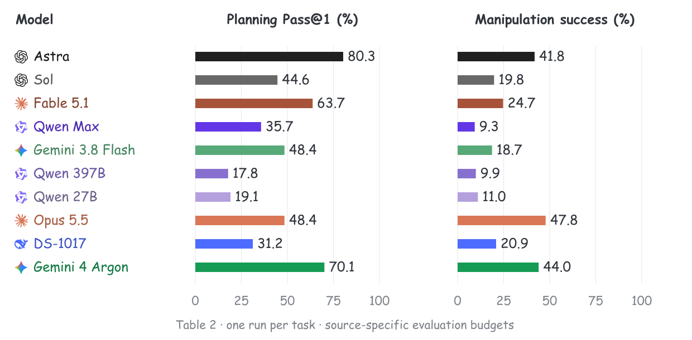

<h1 align="center">
  &nbsp; Embodied Agent&nbsp;Arena
</h1>

<h3 align="center">
  Are Frontier VLM Agents Ready to Be Robot&nbsp;Generalists?<br>
  <em>An Empirical Study with the Embodied&nbsp;Agent&nbsp;Arena</em>
</h3>

<p align="center">
  <a href="https://embodied-agent-arena.github.io/embodied-agent-arena/">🌐&nbsp;Project&nbsp;Page</a> ·
  <a href="https://embodied-agent-arena.github.io/embodied-agent-arena/paper.pdf">📄&nbsp;Latest&nbsp;Manuscript</a> ·
  <a href="https://arxiv.org/abs/2610.00854">arXiv</a> ·
  <a href="https://huggingface.co/datasets/uuu-Quant/Embodied-Agent-Arena">🤗&nbsp;Dataset</a> ·
  <a href="https://embodied-agent-arena.github.io/embodied-agent-arena/case-atlas.html">🎬&nbsp;Case&nbsp;Atlas</a>
</p>

<div align="center">

<p>
Haojian&nbsp;Huang<sup>1,3</sup> · Pukun&nbsp;Zhao<sup>3</sup>&nbsp;· Zexi&nbsp;Li<sup>2,3</sup> · Yehang&nbsp;Zhang<sup>1,3</sup> · Yangkai&nbsp;Wei<sup>3</sup><br>
Wenqian&nbsp;Li<sup>3</sup>&nbsp;· Han&nbsp;Yang<sup>3</sup>&nbsp;· Kaiwen&nbsp;Zhou<sup>3</sup>&nbsp;· Ying&#8209;Cong&nbsp;Chen<sup>1,3,†</sup> · Yinchuan&nbsp;Li<sup>3,†</sup>
</p>

<p><sup>1</sup>&nbsp;HKUST&nbsp;(GZ) &nbsp; <sup>2</sup>&nbsp;The Chinese University of Hong&nbsp;Kong &nbsp; <sup>3</sup>&nbsp;Knowin&nbsp;AI<br>
<sup>†</sup>&nbsp;Corresponding&nbsp;authors</p>

</div>

---

Official repository for **Embodied Agent Arena**, a study of the **native embodied generalist capabilities** of frontier VLM agents. We evaluate **10 models on 1,000 cases across five capabilities**, combining 32 established sources with **GeoProbe**, our 168-case geometry benchmark. A shared minimal harness leaves task interpretation, reasoning, and action selection to the model.


Manipulation suites such as [LIBERO](https://arxiv.org/abs/2306.03310), [RoboTwin 2.0](https://robotwin-platform.github.io/), and [RoboDojo](https://arxiv.org/abs/2607.04434) test transfer and robustness through robot interaction. The Arena also **measures geometry, spatial inference, and visual grounding directly**, linking these capabilities to planning and manipulation outcomes. [Benchmark comparison ↗](https://embodied-agent-arena.github.io/embodied-agent-arena/#benchmark-comparison)

<a id="key-findings"></a>

## 🔎 Key Findings

- **Leading local scores still leave goals unfinished.** Gemini&nbsp;4&nbsp;Argon has the lowest 3D path error, **0.310 m**, yet only **24/56** paths satisfy all constraints. The highest recorded Manipulation success, from Opus&nbsp;5.5, is **47.8%**.
- **Model diversity adds coverage, but shared failures remain.** Across the same **157 Planning tasks**, at least one model completes **142**, adding **16** beyond Astra alone; **15 defeat all ten**. [Task-level analysis ↗](https://embodied-agent-arena.github.io/embodied-agent-arena/technical-report.html#coverage)
- **Sequence depth and precision contact pose distinct demands.** In CALVIN, **60/100** episodes reach the first goal; only **9** finish all five. In the five-task ManiSkill diagnostic, Opus&nbsp;5.5 completes picking, placement, and stacking, but neither peg nor charger insertion. [Evidence and scope ↗](docs/EXPERIMENT_FINDINGS_AUDIT.md)
- **Failures dominate token use.** Astra’s **31 failed tasks consume 55.5% of its tokens**. A failed task uses **5.1×** the tokens of a successful one on average. Matched execution traces distinguish productive recovery from repeated activity. [Execution analysis ↗](https://embodied-agent-arena.github.io/embodied-agent-arena/technical-report.html#resources)
- **Executable again does not mean completed.** In **100 CALVIN episodes**, **65** encounter execution errors; **62** later execute code without an error, but only **3** subsequently complete the sequence. [Figure and per-model evidence ↗](docs/SPATIAL_RECOVERY.md)



<a id="cross-model-results"></a>

## 📊 Cross-Model Results

<!-- BEGIN RESULT_TABLE -->
| Model | Rot.&nbsp;↓ | Trans.&nbsp;↓ | Spatial&nbsp;↑ | AbsRel&nbsp;↓ | Box&nbsp;↑ | Polygon&nbsp;↑ | Plan&nbsp;↑ | Manip.&nbsp;↑ |
| :--- | ---: | ---: | ---: | ---: | ---: | ---: | ---: | ---: |
| GPT&#8209;6&nbsp;Astra | **17.2**&nbsp;±&nbsp;6.7 | 106.9&nbsp;±&nbsp;36.0 | 69.4&nbsp;±&nbsp;1.0 | 0.214&nbsp;±&nbsp;0.016 | 0.286&nbsp;±&nbsp;0.010 | 0.379 | **80.3** | 41.8 |
| GPT&#8209;6&nbsp;Sol | 27.0&nbsp;±&nbsp;1.5 | 151.9&nbsp;±&nbsp;6.2 | 60.7&nbsp;±&nbsp;2.5 | 0.273&nbsp;±&nbsp;0.016 | 0.264&nbsp;±&nbsp;0.010 | 0.325 | 44.6 | 19.8 |
| Claude&nbsp;Fable&nbsp;5.1 | 24.2&nbsp;±&nbsp;8.3 | 116.6&nbsp;±&nbsp;42.6 | 62.0&nbsp;±&nbsp;4.6 | 0.185&nbsp;±&nbsp;0.011 | 0.284&nbsp;±&nbsp;0.013 | 0.328 | 63.7 | 24.7 |
| Qwen&nbsp;3.8&nbsp;Max | 20.5&nbsp;±&nbsp;3.5 | 138.1&nbsp;±&nbsp;10.2 | 68.9&nbsp;±&nbsp;1.1 | 0.206&nbsp;±&nbsp;0.033 | 0.272&nbsp;±&nbsp;0.017 | 0.307 | 36.9 | 9.3 |
| Gemini&nbsp;3.8&nbsp;Flash | 23.7&nbsp;±&nbsp;5.6 | 138.0&nbsp;±&nbsp;41.7 | 65.4&nbsp;±&nbsp;1.3 | **0.161**&nbsp;±&nbsp;0.028 | 0.251&nbsp;±&nbsp;0.081 | 0.291 | 48.4 | 18.7 |
| Qwen&nbsp;3.5&nbsp;397B&#8209;A17B | 38.4&nbsp;±&nbsp;1.1 | 249.8&nbsp;±&nbsp;10.2 | 50.6&nbsp;±&nbsp;1.8 | 0.251&nbsp;±&nbsp;0.027 | 0.116&nbsp;±&nbsp;0.014 | 0.092 | 19.1 | 9.9 |
| Qwen&nbsp;3.5&nbsp;27B | 38.4&nbsp;±&nbsp;3.6 | 213.7&nbsp;±&nbsp;12.6 | 48.0&nbsp;±&nbsp;0.9 | 0.288&nbsp;±&nbsp;0.023 | 0.013&nbsp;±&nbsp;0.006 | 0.051 | 19.1 | 11.0 |
| Claude&nbsp;Opus&nbsp;5.5 | 23.4&nbsp;±&nbsp;3.7 | 135.8&nbsp;±&nbsp;12.7 | 67.5&nbsp;±&nbsp;5.1 | 0.184&nbsp;±&nbsp;0.040 | 0.311&nbsp;±&nbsp;0.020 | 0.397 | 48.4 | **47.8** |
| DeepSeek&nbsp;4.1&nbsp;Flash&#8209;1017 | 30.2&nbsp;±&nbsp;3.9 | 182.0&nbsp;±&nbsp;29.0 | 51.6&nbsp;±&nbsp;1.5 | 0.309&nbsp;±&nbsp;0.035 | 0.217&nbsp;±&nbsp;0.011 | 0.249 | 31.2 | 20.9 |
| Gemini&nbsp;4&nbsp;Argon | 18.5&nbsp;±&nbsp;1.8 | **105.6**&nbsp;±&nbsp;9.6 | **71.6**&nbsp;±&nbsp;0.7 | 0.169&nbsp;±&nbsp;0.023 | **0.356**&nbsp;±&nbsp;0.009 | **0.441** | 70.1 | 44.0 |
<!-- END RESULT_TABLE -->

**Units:** Rotation (°), Translation (cm), Spatial/Plan/Manip. (%), AbsRel (relative error), Box/Polygon (IoU). **Bold** marks the best mean. Mean ± run SD uses five runs (Fable: three); Polygon, Planning and Manipulation use one run.

[**Interactive Results**](https://embodied-agent-arena.github.io/embodied-agent-arena/#results) · [Results CSV](public/data/model-comparison.csv) · [Exact Model IDs & Settings](https://embodied-agent-arena.github.io/embodied-agent-arena/model-guide.html#protocol) · [Recorded Protocol Audit](docs/W4_PROTOCOL_AUDIT.md)

<a id="explore-the-evidence"></a>

## 🎬 Explore the Evidence

- **[Case Atlas](https://embodied-agent-arena.github.io/embodied-agent-arena/case-atlas.html)** — 181 cases across all five capabilities, each with ten-model records; 362 evaluation scene previews and 3 separately labeled demos. Missing footage uses shared task scenes; API interruptions count as unsuccessful attempts and are labeled API error. [Media coverage ↗](docs/CASE_MEDIA.md)
- **[Same Task. Ten Models.](https://embodied-agent-arena.github.io/embodied-agent-arena/#cases)** — 11 fixed tasks × 10 models. Visible clips play automatically; click for the matching result.
- **[Inside the Execution](https://embodied-agent-arena.github.io/embodied-agent-arena/#execution-analysis)** — Follow actions, feedback and goal progress. All ten models are selectable on each of 46 tasks, including Gemini&nbsp;4&nbsp;Argon’s recorded actions and feedback.
- **[Results & Reproduction](docs/RESULTS.md)** — Main and source-level CSVs, task outcomes, analysis scripts, and editable manuscript figures.

All pages and documentation are in English. Translated task instructions link to their original evaluation prompts. [Language and source records](docs/LANGUAGE.md).

<a id="news"></a>

## 📰 News

- **2026.10.23** — Refreshed all **39 Qwen HumanCLAW records** and added **38 observation replays**. Planning results, figures and the current author manuscript are synchronized. [Results, footage and error outcomes](docs/HUMANCLAW_QWEN_REFRESH.md) · [All 39 runs](https://embodied-agent-arena.github.io/embodied-agent-arena/humanclaw-refresh.html).
- **2026.10.23** — Submitted the current **73-page manuscript** as a replacement of [arXiv:2610.00854](https://arxiv.org/abs/2610.00854), including the Qwen HumanCLAW refresh and expanded analyses. Announcement is pending.

- **2026.10.22** — Updated **all ten models in the spatial diagnostics** and released **100-episode CALVIN recovery analysis**, with matching figures, data and revised manuscript.
- **2026.10.22** — Recovered **30 original case videos** by exact task, model and report matching; refreshed the compact Case Atlas with ten-model comparisons and labeled scene context for unrecorded executions.

- **2026.10.22** — Filled the homepage media slots with 13 original videos, 3 labeled same-task demos and one observation sequence; redesigned Affordance and Planning figures and moved the supplementary review table to the appendix.
- **2026.10.21** — Added **Gemini&nbsp;4&nbsp;Argon’s execution logs** to same-task comparisons and ten-model time, token-use and recovery analyses.
- **2026.10.21** — Added **Gemini&nbsp;4&nbsp;Argon** (`gemini-4-argon`): ten-model results, matched case comparisons, Planning outcomes and updated manuscript figures.
- **2026.10.20** — Released **direct-polygon comparisons and execution analysis** with task-matched videos, actions and feedback.
- **2026.10.19** — Added **DeepSeek&nbsp;4.1&nbsp;Flash&#8209;1017**, expanding the comparison to **nine models**; integrated polygon Affordance results and completed Opus&nbsp;5.5 Planning results.
- **2026.10.15** — Expanded the **eight-model video gallery** with task-matched recordings, instructions and run details.
- **2026.10.12** — Added **Claude&nbsp;Opus&nbsp;5.5**, expanding the quantitative comparison to **eight models**; introduced the **Case Atlas** and qualitative manuscript figures.
- **2026.10.05** — Published the **seven-model comparison**, downloadable results and the model selection and evaluation guide.
- **2026.10.01** — Released the **evaluation harness and 1,000-case dataset**.

<a id="release-status"></a>

## ✅ Release Status

- [x] **Paper and project page** — [Latest author manuscript](https://embodied-agent-arena.github.io/embodied-agent-arena/paper.pdf), results and case studies.
- [x] **Evaluation code and data** — [Harness and setup](#quick-start), [benchmark adapters](docs/INSTALL.md), and a pinned dataset release.
- [x] **Results and analysis reports** — [Ten-model exports and task outcomes](docs/RESULTS.md), plus the published execution records and analyses.
- [x] **Analysis tools and figure sources** — [Rebuild scripts](docs/RESULTS.md#rebuild-the-public-outputs) and [editable draw.io figures with SVG/PDF/PNG exports](https://embodied-agent-arena.github.io/embodied-agent-arena/assets/analysis/editable-figures.zip).
- [x] **Gemini&nbsp;4&nbsp;Argon execution logs** — Matched 109 gallery records; added time, token use and recovery across 157 Planning episodes.

<a id="benchmark"></a>

## 🧩 Benchmark

**GeoProbe** evaluates camera motion, object displacement, depth, and scale. Controlled Blender scenes isolate these geometric factors; real images extend the evaluation to natural scenes.

| Capability | Cases | What the agent must do |
| :--- | ---: | :--- |
| **Geometry** | 370 | Estimate camera parameters, depth, motion, and scale; trace spatial paths. |
| **Spatial Reasoning** | 220 | Relate objects and viewpoints, compare distances, and reason about scene layout. |
| **Task Planning** | 157 | Coordinate actions and feedback to satisfy household and scientific goals. |
| **Manipulation** | 183 | Execute placement, insertion, articulation, and sequential control tasks. |
| **Affordance** | 70 | Locate usable contacts and functional regions for an intended action. |

<a id="quick-start"></a>

## 🚀 Quick Start

### 1. Install

Use Linux and Python 3.10 or newer. From the repository root:

```bash
python3 -m venv .venv
source .venv/bin/activate
python -m pip install -e '.[offline,test,hub]'
```

For Task Planning and Manipulation, also follow the [interactive environment installation guide](docs/INSTALL.md) for the benchmarks you want to run.

### 2. Download the dataset

Download the [Hugging Face dataset](https://huggingface.co/datasets/uuu-Quant/Embodied-Agent-Arena) at its fixed release revision and validate it:

```bash
python scripts/fetch_data.py \
  --repo-id uuu-Quant/Embodied-Agent-Arena \
  --revision 5f729375eb35163a024625dd8ea72ac57a427a24 \
  --output ../data
arena validate --data-root ../data --hashes
arena list --data-root ../data
```

### 3. Run an evaluation

Copy [.env.example](.env.example) to `.env` and fill in your credentials. Replace `MODEL_ID` with your API model ID:

```bash
arena run --data-root ../data --benchmark w1_vlm_depth -- \
  --provider openai-compatible --model MODEL_ID --env-file .env \
  --workers 1 --retry-http --max-http-rounds 3 --output-dir outputs/evaluation
```

Select tasks with `--wave`, `--benchmark`, or `--case`. Add `--dry-run` to inspect the plan; repeat the command to resume its checkpoint. GPU environments require device and memory settings described in the [installation guide](docs/INSTALL.md).

For **multiple models**, edit [configs/batch.example.json](configs/batch.example.json), then run:

```bash
arena batch --config configs/batch.example.json --output-dir outputs/batch --execute
```

To **score saved offline predictions**, provide JSONL records with `task_id` and `answer` fields:

```bash
arena score --data-root ../data --benchmark w5_umd \
  --predictions predictions.jsonl --output outputs/scores.jsonl
```

<a id="citation"></a>

## 📖 Citation

If this work is useful for your research, please cite:

<!-- BEGIN CITATION -->
```bibtex
@article{huang2026frontier,
  title={Are Frontier VLM Agents Ready to Be Robot Generalists? An Empirical Study with the Embodied Agent Arena},
  author={Huang, Haojian and Zhao, Pukun and Li, Zexi and Zhang, Yehang and Wei, Yangkai and Li, Wenqian and Yang, Han and Zhou, Kaiwen and Chen, Ying-Cong and Li, Yinchuan},
  journal={arXiv preprint arXiv:2610.00854},
  year={2026}
}
```
<!-- END CITATION -->
