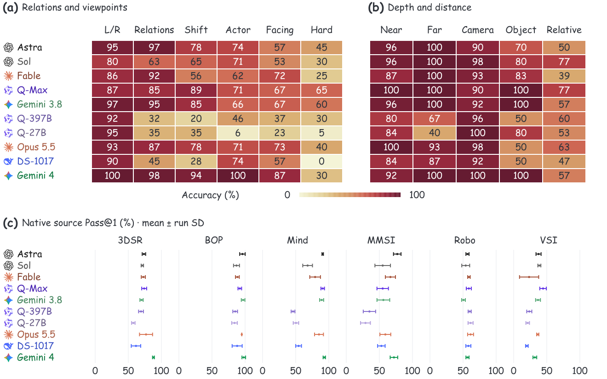
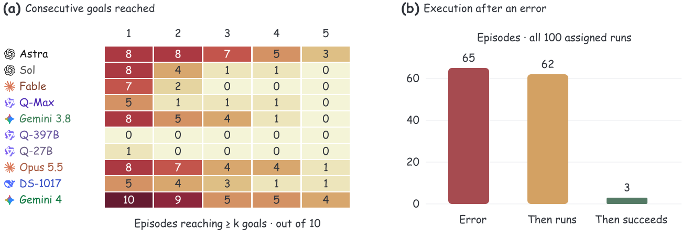

# Spatial strengths and recovery

Figure 5 compares **all ten models** on the same spatial questions. Figure 8 distinguishes **resuming executable code** from **completing the task**, using every adopted CALVIN episode.

## Spatial reasoning

Gemini 4 Argon reaches **93.8%** on camera shifts and **86.7%** on object-facing questions, versus Astra’s **78.5%** and **56.7%**. On hard video directions, however, Gemini 4 scores **30%**, behind Gemini 3.8 Flash at **60%** and Qwen Max at **65%**. Spatial improvements depend on the relation and source.

The former Figure 5(a) label “Gemini” refers to **Gemini 3.8 Flash**, verified against the original task and run records. Its left/right accuracy is 96.7%; Gemini 4 Argon reaches 100% on those same questions. Both models are now named separately in every panel.

The heatmaps retain the original 0–100 warm scale. They show mean accuracy across five runs (three for Fable), rounded to integers. Each model sees the same task IDs within a column. The eleven columns contain 12, 12, 13, 7, 6, 4, 5, 3, 10, 2 and 6 distinct cases, respectively; run SD and exact values are available in the data. Panel (c) covers all 220 Spatial cases across six sources, including numerical questions under their native success criteria.

## Manipulation recovery

Across **100 CALVIN episodes**, ten sequences for each of ten models, **60 reach the first goal and nine complete all five**. Gemini 4 Argon completes four sequences, GPT-6 Astra three, and Claude Opus 5.5 and DeepSeek 4.1 Flash-1017 one each.

The recovery gap spans models. DeepSeek 4.1 Flash-1017 resumes code in all ten episodes with an execution error; Claude Opus 5.5 and Claude Fable 5.1 each resume in all nine. Only one, one, and zero of those episodes finish, respectively. Across all ten models, **65** episodes contain execution errors, **62** later execute code without an error, and only **3** subsequently complete all five goals. Six of the nine complete sequences finish without a preceding execution error.

These are nested episode counts, not error-event totals. Execution errors include syntax, interface-contract and native runtime/tool failures; transport failures, timeouts and budget guards are excluded. “Resumed” requires a later `execution_ok=true` round. “Then complete” requires a later native-success round. Neither resuming code nor a large action count establishes physical progress.

Six records lack a verified prefix: one Qwen Max and five Qwen 397B episodes. They receive no goal credit in panel (a), keeping the ten-task denominator; their prefixes remain `null` in the released data. The other 94 prefixes are explicit. Mean prefixes and full-sequence counts reproduce the adopted CALVIN aggregates. [Recorded settings](W4_PROTOCOL_AUDIT.md) remain attached to each episode.

## Data and reproduction

- [Spatial case-run outcomes](../public/data/spatial-recovery/spatial-trials.csv): 10,560 rows; fixed task IDs and run indices.
- [Spatial means, SD and source manifest hashes](../public/data/spatial-recovery/spatial-summary.json).
- [CALVIN event summaries and report hashes](../public/data/spatial-recovery/calvin-episodes.json): all 100 adopted episodes.
- [CALVIN per-model counts](../public/data/spatial-recovery/calvin-models.csv) and [summary](../public/data/spatial-recovery/calvin-summary.json).
- [Adopted successes across all thirteen Manipulation sources](../public/data/spatial-recovery/manipulation-sources.json).
- [Editable draw.io figures with SVG, PDF and PNG exports](../public/assets/analysis/editable-figures.zip).

Run `python3 scripts/check_spatial_recovery.py` from the repository root to recompute the published spatial cells and CALVIN counts. Event summaries are extracted from SHA-256-verified reports; raw prompts and filesystem paths are omitted. The CALVIN analysis uses the original seven-model records and the adopted Opus, DeepSeek and Gemini 4 reports. Later archived executions are not substituted for these aggregate populations.
